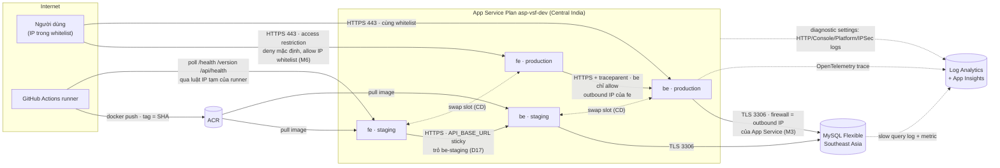
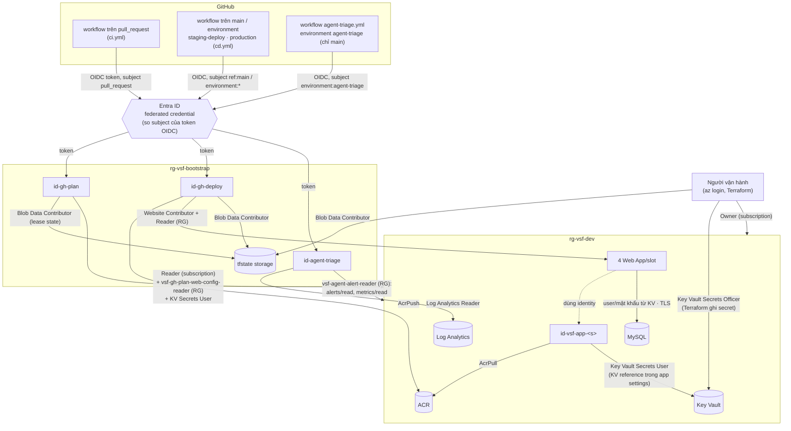
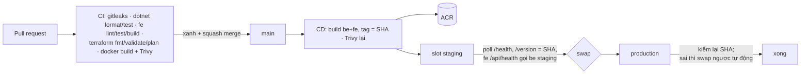

# Architecture — OpsBoard trên Azure App Service

Liên quan: [brief](docs/docs_app/brief.md) · [api-spec](docs/docs_app/api-spec.md) · [database-schema](docs/docs_app/database-schema.md) ·
[README](README.md) (dựng lại từ đầu) · [runbook](runbook.md) · [logging](docs/logging.md).
Mã nguồn: backend `app/be`, frontend `app/fe`, test `app/be.Tests`. Hạ tầng: `infra/bootstrap` (một lần) và `infra/app` (dựng/tắt hằng ngày).

Hai sơ đồ dưới **tách riêng** luồng traffic và luồng xác thực/quyền (`topic.md`). Mỗi mũi tên ghi giao thức, danh tính và role.
Bảng ở mục 4 lấy từ `az role assignment list` chạy thật ngày 2026-10-01 trên môi trường `jcip0s`.

> **Đã chốt 2026-09-21 (Q10):** **hai service** `fe` (Next.js) và `be` (.NET) là hai Web App riêng trên **cùng một**
> App Service Plan. Hệ quả: hai image trong ACR, CD build và swap hai lần, access restriction đặt cho cả hai,
> trace có chặng `fe → be` thật.

## 1. Thành phần

| Thành phần | Tên (suffix `<s>` sinh ngẫu nhiên mỗi lần dựng) | Công nghệ | Vai trò |
|---|---|---|---|
| `fe` (`app/fe`) | `fe-vsf-<s>` + slot `staging` | Next.js, container | Giao diện; route handler phía server gọi `be` (BFF), trình duyệt không gọi thẳng `be` |
| `be` (`app/be`) | `app-vsf-<s>` + slot `staging` | .NET 10 ASP.NET Core, container | Nghiệp vụ ticket, `/health` `/version` `/load` `/items` `/boom` |
| App Service Plan | `asp-vsf-dev` | P0v3 Linux, autoscale 1–2 (M7) | Chạy cả `fe` và `be` |
| MySQL | `mysql-vsf-<s>-sea` | Flexible Server 8.4 B1ms, **Southeast Asia** | Dữ liệu ticket; app ở Central India (`known-issues.md` #27) |
| ACR | `acrvsf<s>` | Basic, admin tắt | Image `vsf-be`, `vsf-fe`, tag = git SHA |
| Key Vault | `kv-vsf-<s>` | RBAC mode | Mật khẩu MySQL, connection string App Insights |
| MI của app | `id-vsf-app-<s>` | user-assigned | Pull ACR; đọc Key Vault |
| Log Analytics + App Insights | `log-vsf-<s>`, `appi-vsf-<s>` | workspace-based, 30 ngày, cap 0,2 GB/ngày | Log, metric, trace, alert, Workbook (M11) |
| State Terraform | `rg-vsf-bootstrap` / `stvsftf<…>` | Storage, tắt shared key, versioning | State `infra/app` (state `infra/bootstrap` để local) |
| Danh tính GitHub | `id-gh-plan`, `id-gh-deploy`, `id-agent-triage` | user-assigned MI + federated credential | CI plan · CD deploy · agent đọc sự cố (D23) |

## 2. Luồng traffic

- **Biên mạng = IP.** Không có token hay mTLS giữa `fe` và `be`; chặn theo IP là toàn bộ bảo vệ của `be` (rủi ro R5,
  `docs/docs_app/brief.md`). Cả 4 bề mặt (2 app × production/staging) và SCM đều deny mặc định (`m6-check.yml`).
- **Firewall MySQL** sinh từ `possible_outbound_ip_address_list` của `be`, nên `make up` phải apply 3 pha (`Makefile`).
- **Swap** chỉ xảy ra sau khi staging trả đúng SHA mới và `fe` staging gọi được `be` staging (`cd.yml`, D17).
  Cổng này chỉ nhìn `/health`·`/version`, không gọi `/items` (drill 2 D24 chứng minh hệ quả).

## 3. Luồng xác thực và quyền

Không có client secret ở đâu cả: tenant cấm tạo app registration (Q6) nên mọi danh tính ngoài Azure là
user-assigned MI + federated credential. "Chỉ `main` deploy được" có 3 lớp: subject của token, deployment branch policy
của environment, và ruleset `protect-main` (0 bypass).

## 4. Danh tính → role → scope (đo 2026-10-01)

| Danh tính | Role | Scope | Dùng cho |
|---|---|---|---|
| `id-vsf-app-<s>` | AcrPull | ACR | App Service kéo image |
| `id-vsf-app-<s>` | Key Vault Secrets User | Key Vault | KV reference (mật khẩu DB, App Insights) |
| `id-gh-plan` | Reader | subscription | `terraform plan` trên PR |
| `id-gh-plan` | `vsf-gh-plan-web-config-reader` (custom: `sites/config/list/action`, `sites/slots/config/list/action`) | `rg-vsf-dev` | plan refresh auth settings của Web App |
| `id-gh-plan` | Key Vault Secrets User | Key Vault | plan đọc secret `mysql-admin-password` |
| `id-gh-plan` | Storage Blob Data Contributor | storage state | lease state khi plan |
| `id-gh-deploy` | AcrPush | ACR | CD push image |
| `id-gh-deploy` | Website Contributor | `rg-vsf-dev` | đặt image slot staging, swap, luật IP tạm |
| `id-gh-deploy` | Reader | `rg-vsf-dev` | `az acr show` (AcrPush không có quyền control plane) |
| `id-gh-deploy` | Storage Blob Data Contributor | storage state | — |
| `id-agent-triage` | Log Analytics Reader | workspace `log-vsf-<s>` | KQL (agent đọc sự cố) |
| `id-agent-triage` | `vsf-agent-alert-reader` (custom: `AlertsManagement/alerts/read`, `Insights/metrics/read`, `Insights/metricDefinitions/read`) | `rg-vsf-dev` | alert đang bắn, metric |
| người vận hành | Owner | subscription | Terraform apply/destroy |
| người vận hành | Key Vault Secrets Officer | Key Vault | Terraform ghi secret |
| người vận hành | Storage Blob Data Contributor | storage state | backend `azurerm` dùng Entra (shared key tắt) |

Chứng minh ngược: M5 (gỡ Secrets User của MI → app gãy, `evidence/M5.md`), agent (`evidence/agent.md`),
CI không deploy được (`evidence/M10.md`).

## 5. Luồng triển khai

Rollback tay: swap ngược staging ↔ production (slot giữ bản trước) — `docs/rollback.md`, `runbook.md`.

## 6. Observability

- **Log:** JSON một dòng mỗi request (`method`, `path`, `status`, `duration_ms`, `trace_id`, `span_id`) ra stdout →
  `AppServiceConsoleLogs`; thêm `AppServiceHTTPLogs`, `AppServicePlatformLogs`, `AppServiceIPSecAuditLogs`, MySQL slow log.
- **Trace:** OpenTelemetry `fe` + `be` → App Insights workspace-based (`AppRequests`, `AppDependencies`, `AppExceptions`).
  Khoá nối log ↔ trace là `trace_id` **và** `span_id` (`known-issues.md` #29).
- **Alert:** 5xx rate > 5% (log) · CPU plan · MySQL connections → action group `ag-vsf-oncall` (email).
- **Dashboard:** Workbook (không dùng dashboard App Insights) — `evidence/M11.md`.
- **Agent đọc sự cố:** `agent-triage.yml` chạy cùng các truy vấn trên bằng danh tính chỉ đọc — `evidence/agent.md`.

## 7. Quyết định và đánh đổi

| Quyết định | Lý do | Đánh đổi |
|---|---|---|
| Hai service trên một plan | Đúng ý Next.js + .NET; trace có chặng thật | Gấp đôi CI/CD, swap, whitelist |
| BFF trong Next.js | `be` không lộ cho trình duyệt | Thêm một chặng độ trễ |
| Tên thay cho đăng nhập | Đề không cần auth; mạng công ty là biên tin cậy | Không chống giả danh |
| IP whitelist thay Private Endpoint | Rẻ, đủ cho bài; Free Trial | Biên mạng phụ thuộc IP động (`known-issues.md` #11, #19) |
| MySQL Southeast Asia, App Central India | Subscription không tạo được MySQL ở Central India | ~50 ms mỗi lệnh SQL (#27) |
| MI + federated credential cho GitHub | Tenant cấm app registration | Mỗi environment mới cần thêm credential |
| State bootstrap để local | Bootstrap tạo ra chính storage chứa state | Mất thư mục là mất state (#17, đã dựng lại D23) |
