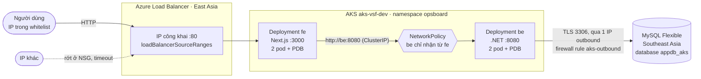
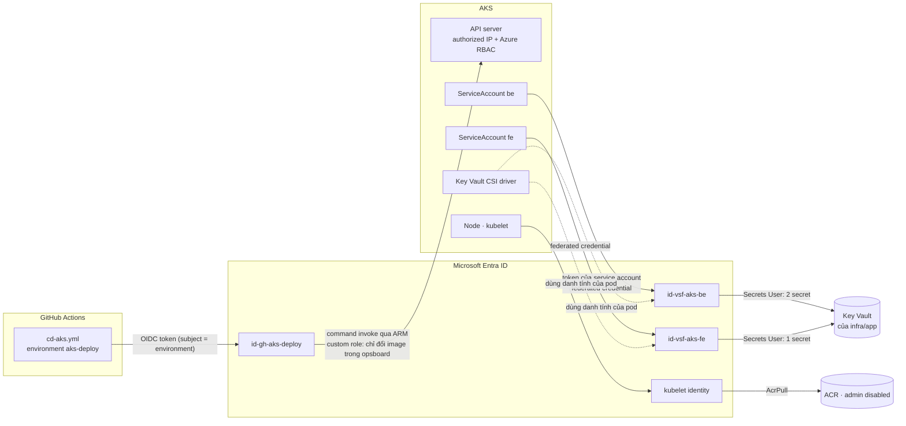

# AKS — phần ADVANCED

> **Ngoài phạm vi `topic.md`.** Đề bài (M1–M11, S1–S3) được nộp trên App Service. Tài liệu này mô tả
> một đích deploy **thứ hai**, làm thêm từ 12/10, cho cùng app OpsBoard. Bằng chứng: `evidence/advanced/`.
> Kế hoạch và quyết định: `docs/plans/active/aks-advanced.md`.

Nguyên tắc: **chỉ thêm**. Không dòng nào của `infra/app`, `cd.yml`, `ci.yml`, `app/` bị sửa; AKS dùng lại
ACR, Key Vault, MySQL và action group của bài chính bằng cách đọc chúng và thêm resource con.

## 1. Kiến trúc

### Luồng traffic



### Luồng auth



Không có secret tĩnh ở bất kỳ mũi tên nào: GitHub → Azure bằng OIDC, pod → Key Vault bằng Workload
Identity, node → ACR bằng managed identity, người → cluster bằng token Entra.

## 2. App Service ↔ AKS — cùng yêu cầu, khác cơ chế

| Yêu cầu | App Service (bài chính) | AKS (advanced) |
|---|---|---|
| M1 pull image | Web App pull bằng user-assigned MI | kubelet identity + `AcrPull`, manifest không có `imagePullSecrets` |
| M2 zero-downtime | swap slot staging → production | rolling update `maxSurge 1 / maxUnavailable 0` + readiness probe + `preStop sleep` |
| M3 MySQL | firewall theo ~20 "possible outbound IP" dùng chung stamp, apply nhiều pha | firewall theo **1** IP outbound của riêng cluster, apply một pha; database riêng `appdb_aks` |
| M4/M5 secret | app setting `@Microsoft.KeyVault(...)` | Workload Identity + Key Vault CSI, role ở scope từng secret |
| M5 chứng minh ngược | reference không resolve → app thoát | pod mới kẹt `ContainerCreating` (`FailedMount`) |
| M6 whitelist | `ip_restriction` 8 bề mặt (site + Kudu × slot × 2 app) → **403** | `loadBalancerSourceRanges` cho `fe` + `authorized_ip_ranges` cho API server → **timeout**; `be` không có IP công khai |
| M7 autoscale | autoscale trên Plan, 1–2 instance | cluster autoscaler 1–2 node; HPA `be` trần 2 (đo co giãn 1→2→1 với min 1, rồi nâng min lên 2 — xem mục 6) |
| M8 Terraform | `make up` 3 pha | `make aks-up` 1 pha (`infra/aks`, state riêng) |
| M9 CI | 9 required check trong `ci.yml` | các cổng chung tự phủ file mới + `ci-aks.yml` (plan, kubeconform, shellcheck) |
| M10 CD | build → Trivy → push → slot staging → swap | `cd-aks.yml` chạy sau "CD": đổi tag image, `rollout status`, kiểm SHA, sai thì `rollout undo` |
| M11 monitoring | `AppServiceHTTPLogs` + metric Plan | Container Insights + `AppRequests`, workspace riêng |
| `fe` → `be` | vòng ra Internet, `be` whitelist outbound IP của `fe` | `http://be:8080` trong cluster |
| TLS | `https_only` + chứng chỉ của nền tảng | **không có** — HTTP sau whitelist (known-issues) |

## 3. Vận hành

```bash
# một lần
cp infra/aks/terraform.tfvars.example infra/aks/terraform.tfvars   # điền IP, giống infra/app
az aks install-cli --install-location ~/.local/bin/kubectl --kubelogin-install-location ~/.local/bin/kubelogin

make aks-up            # terraform apply (TỐN TIỀN) → kubeconfig → áp manifest → bảng kiểm
make aks-verify        # bảng kiểm chỉ đọc, chạy lại bất cứ lúc nào
make aks-deploy        # áp lại manifest sau khi sửa k8s/base (giữ nguyên tag image đang chạy)
make aks-down          # cuối buổi — TRƯỚC `make down`
make aks-check-empty   # hai RG phải không còn
```

Cần môi trường nền (`make up`) đang bật: `infra/aks` tra ACR, Key Vault, MySQL bằng data source.

Một lần cho mỗi subscription/repo (để `cd-aks.yml` đăng nhập được), sau khi `infra/bootstrap` đã apply `aks.tf`:

```bash
R=repos/<owner>/<repo>
echo '{"deployment_branch_policy":{"protected_branches":false,"custom_branch_policies":true}}' \
  | gh api -X PUT "$R/environments/aks-deploy" --input -
gh api -X POST "$R/environments/aks-deploy/deployment-branch-policies" -f name=main -f type=branch
gh variable set AZURE_CLIENT_ID_AKS_DEPLOY --body "$(terraform -chdir=infra/bootstrap output -raw gh_aks_deploy_client_id)"
```

Environment **phải** được tạo tay kèm luật "chỉ `main`" trước khi workflow chạy lần đầu: environment do GitHub tự
sinh thì không giới hạn nhánh, và federated credential chỉ kiểm subject `environment:aks-deploy`.

Ai sở hữu gì — giống cách chia của bài chính (Terraform sở hữu Web App, CD sở hữu tag image):

| Thứ | Ai đổi | Bằng gì |
|---|---|---|
| Cluster, identity, role, firewall, database, monitoring | người vận hành | `make aks-up` (`infra/aks`) |
| Namespace, Deployment, Service, HPA, NetworkPolicy, SecretProviderClass | người vận hành | `make aks-deploy` (`k8s/base` + `scripts/aks-render.sh`) |
| **Tag image** của `be`, `fe` | CD | `cd-aks.yml` → `scripts/aks-cd.sh` |
| Số node | cluster autoscaler (1–2) | — |
| Số pod `be` | HPA (2–2: trần của luật project, sàn vì gỡ node) | — |

## 4. Deploy và rollback

Merge PR vào `main` → `cd.yml` (App Service) build, quét Trivy, push `vsf-be:<sha>` + `vsf-fe:<sha>`, swap
→ **xanh** → `cd-aks.yml` tự chạy: đổi tag `be`, chờ rollout, đổi tag `fe`, chờ rollout, kiểm 5 lần cách 5
giây (curl từ command pod trong cluster) rằng `fe` và `be` cùng trả đúng SHA và `fe` → `be /health` = 200. Cluster đang tắt, hoặc run CD không build
image, thì workflow kết thúc xanh và ghi rõ là bỏ qua.

Rollback **tự động** khi rollout quá 300 giây hoặc bước kiểm thất bại: đặt lại đúng image đã ghi nhớ trước khi
đổi, `fe` rồi `be`, chỉ cho Deployment mà lần chạy đó đã đổi; job đỏ. Không dùng `rollout undo` (lùi về
"revision trước" — không chắc là bản vừa chạy).

Rollback **tay**:

```bash
kubectl -n opsboard rollout history deployment/be
kubectl -n opsboard rollout undo deployment/fe && kubectl -n opsboard rollout undo deployment/be
kubectl -n opsboard rollout status deployment/be
# hoặc deploy lại một SHA cũ còn trong ACR:
gh workflow run cd-aks.yml -f sha=<40 ký tự>
```

Khác swap slot: không có "slot" giữ bản cũ đang chạy sẵn — rollback là một lần rollout nữa, mất bằng thời
gian khởi động pod. Bù lại không cần `sticky_settings` hay luật whitelist tạm cho runner.

<a id="runbook"></a>
## 5. Runbook — alert của AKS

Ba alert (`infra/aks/alerts.tf`), email qua `ag-vsf-oncall`. Workbook: *OpsBoard — AKS advanced*.

| Alert | Xác nhận | Xử lý |
|---|---|---|
| `alert-vsf-aks-5xx-rate` | Workbook ô *Failure rate*; `kubectl -n opsboard logs deploy/be --tail=100`; `curl http://<LB>/api/health` | `be /health` 503 → MySQL (firewall `aks-outbound` còn đúng IP outbound? `make aks-verify`). Lỗi sau một lần deploy → rollback tay ở mục 4. |
| `alert-vsf-aks-pod-not-starting` | `kubectl -n opsboard get pods`; `kubectl -n opsboard describe pod <tên>` đọc mục Events | `ImagePullBackOff` → role `AcrPull` của kubelet identity, tag có trong ACR không. `FailedMount` → role Key Vault của identity `be`/`fe`. `CrashLoopBackOff` → `kubectl logs --previous`. Sửa quyền bằng `make aks-up`, rồi `kubectl -n opsboard rollout restart deployment/<tên>`. |
| `alert-vsf-aks-node-cpu-high` | Workbook ô *CPU node*; `kubectl top pods -n opsboard`; `kubectl get hpa -n opsboard` | Đã 2 pod + 2 node (trần của luật project) mà vẫn cao: tìm request `/load` trong log, hoặc chấp nhận và ghi lại. Không nâng `maxReplicas`/`node_max_count` quá 2. |

Truy vết alert → request: lấy `trace_id` trong log `be` (Workbook ô *Request gần nhất*) → tìm cùng giá trị ở
cột `OperationId` của `AppRequests` / `AppDependencies` trong App Insights `appi-vsf-aks-<suffix>`.

Escalate: như `runbook.md` của bài chính.

## 6. Vì sao 2 bản + PodDisruptionBudget

Đo 12/10 (`evidence/advanced/aks-m9-m10-m2.md`): rolling update không rớt request nào, nhưng **15 phút sau mỗi lần deploy**
có một gián đoạn ~12 giây. Chuỗi nguyên nhân:

1. `cd-aks.yml` chạy `kubectl` qua `az aks command invoke`; AKS dựng một pod tạm xin **200m CPU**.
2. Node 2 vCPU chỉ còn ~259m sau add-on → pod surge của rollout không vừa → cluster autoscaler thêm node thứ hai, pod mới
   rơi sang đó.
3. Node thứ hai thừa → ~15 phút sau bị gỡ → pod trên đó bị đuổi. Với **1 bản**, đó là bản duy nhất.

Sửa ở tầng app chứ không ở tầng nguyên nhân (pod tạm 200m là của AKS, không chỉnh được): mỗi service 2 bản, rải mềm ra 2
node, và `PodDisruptionBudget minAvailable: 1` để việc gỡ node phải chờ bản thay thế Ready rồi mới đuổi bản kế tiếp.

Cái giá, dưới luật "tối đa 2 instance": sàn 2 = trần 2, số pod `be` không còn co giãn. HPA đã được đo co giãn thật với
min 1 (`evidence/advanced/aks-m7.md` mục 1); từ nay co giãn nằm ở tầng node. Đường khác đã cân nhắc và bỏ: PDB với 1 bản
(chặn hẳn việc gỡ node → 2 node mãi mãi), bỏ `command invoke` để CD gọi thẳng API server (phải mở API server cho IP của
runner), giảm request cho vừa cạnh pod tạm (dư đúng 9m, HPA sẽ dao động quanh ngưỡng).
