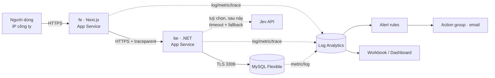
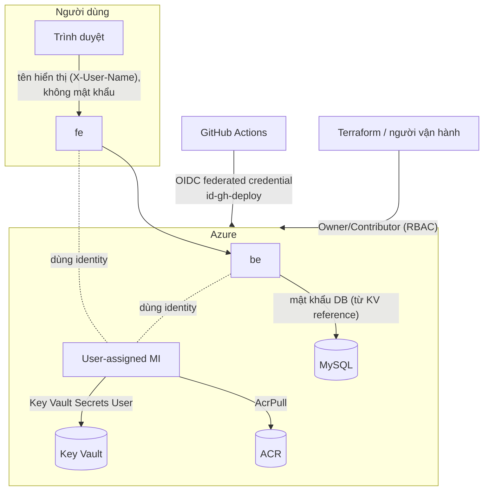
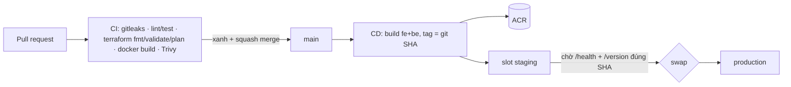

# Architecture — OpsBoard

Liên quan: [brief](brief.md) · [api-spec](api-spec.md) · [database-schema](database-schema.md).
Mã nguồn: backend `app/be`, frontend `app/fe`, test backend `app/be.Tests`. Phần hạ tầng chi tiết (Terraform) nằm ở `infra/`. Sơ đồ dưới tách **luồng traffic** và **luồng xác thực/quyền** (topic.md yêu cầu).

> **Đã chốt 2026-09-21 (Q10):** **hai service** — `fe` (Next.js) và `be` (.NET) là hai Web App riêng trên
> **cùng một** App Service Plan. Hệ quả: hai image trong ACR, CD build và swap hai lần, access restriction
> đặt cho cả hai, và trace có chặng `fe → be` thật.

## 1. Thành phần
| Thành phần | Công nghệ | Vai trò |
|---|---|---|
| `fe` (`app/fe`) | Next.js (TypeScript), container | Giao diện; route handler phía server gọi API (BFF) nên trình duyệt không gọi trực tiếp backend |
| `be` (`app/be`) | .NET 10 ASP.NET Core, container | Nghiệp vụ ticket, `/health`, `/version`, `/load`, `/boom` |
| MySQL | Flexible Server 8.4 (B1ms) | Lưu tickets, comments, activities |
| ACR | Basic, admin disabled | Kho image `fe`, `be` |
| Key Vault | RBAC mode | Mật khẩu MySQL; sau này API key Jev |
| Managed Identity | user-assigned | Pull ACR (`fe` **và** `be`); đọc Key Vault **chỉ `be`** — `fe` không giữ secret nào nên không cần quyền Key Vault (đi theo slot khi swap) |
| Log Analytics + App Insights | workspace-based (chờ Q1) | Log, metric, trace, alert |
| App Service Plan | P0v3 Linux, autoscale 1–2 | Chạy cả `fe` và `be` (một plan, hai web app), mỗi app có slot `staging` |

## 2. Luồng traffic (runtime)

- Chặn IP: cả hai app có access restriction, default deny; `fe` mở cho IP công ty, `be` mở cho outbound IP của `fe`
  và IP quản trị. Chặn theo IP là **hết mức bảo vệ của `be`** — không có token hay mTLS giữa `fe` và `be`;
  rủi ro này đã được chấp nhận (R5 ở `brief.md`), không làm thêm lần này.
- Firewall MySQL chỉ mở cho outbound IP của App Service (M3).
- Trace: trình duyệt → `fe` → `be` → MySQL cùng một `trace_id`; log JSON của cả hai có `trace_id`,
  nên đi được từ alert → KQL → request cụ thể.

## 3. Luồng xác thực và quyền (control plane + data plane)

| Ai | Truy cập gì | Bằng cách nào |
|---|---|---|
| Người dùng cuối | `fe` | Chỉ IP whitelist; danh tính là tên tự nhập (không xác thực). Rủi ro chấp nhận: tên giả. |
| `fe` → `be` | API | HTTPS, IP whitelist; không token |
| `be` → MySQL | Dữ liệu | Mật khẩu ở Key Vault, đọc bằng MI qua `@Microsoft.KeyVault(...)`; TLS |
| App Service → ACR | Image | MI có `AcrPull`, ACR admin tắt |
| GitHub Actions → Azure | Deploy | OIDC, không client secret; `id-gh-plan` (PR) và `id-gh-deploy` (`main`) |
| Người vận hành | Hạ tầng | RBAC (Owner của subscription học) |

Xoá quyền MI khỏi Key Vault → app gãy (chứng minh M5).

## 4. Luồng triển khai

Rollback: swap ngược staging ↔ production (slot giữ bản trước). Chỉ `main` được deploy.

## 5. Observability
- Log: JSON một dòng mỗi request (`method`, `path`, `status`, `duration_ms`, `request_id`, `trace_id`) ra stdout →
  Log Analytics (ConsoleLogs, HTTPLogs, PlatformLogs).
- Metric: App Service (CPU, memory, HTTP queue), MySQL (CPU, connections, storage).
- Trace: `trace_id` (từ `Activity.Current?.TraceId`, **nếu null** thì lấy từ header `traceparent` của `fe` — xem `ai-failure-log.md` #12)
  đã dùng được trong log JSON và header `X-Trace-Id` ngay ở bước viết app. OpenTelemetry ở `fe` và `be`
  (ASP.NET Core, HTTP client, MySqlConnector) chỉ thêm exporter để trace này chạy tới Azure App Insights —
  phần exporter này chờ Q1.
- Alert: 5xx · CPU cao · MySQL connections → action group email.
- Dashboard: response time · request rate · failure rate · hạ tầng · panel xem log · trace.

## 6. Quyết định và đánh đổi
| Quyết định | Lý do | Đánh đổi |
|---|---|---|
| Hai service trên một plan | Đúng ý Next.js + .NET; trace có chặng thật | Gấp đôi CI/CD, swap, whitelist |
| BFF trong Next.js | Backend không lộ trực tiếp cho trình duyệt | Thêm một chặng độ trễ |
| Tên thay cho đăng nhập | Đề không cần auth; mạng công ty là biên tin cậy | Không chống giả danh |
| `TriageProvider` là interface | Nối Jev sau mà không đổi API | Chưa có giá trị khi chưa gọi Jev |
| MySQL Southeast Asia, App Central India | Ràng buộc throttle/quota subscription (xem plan Decisions) | Thêm latency giữa hai vùng |
