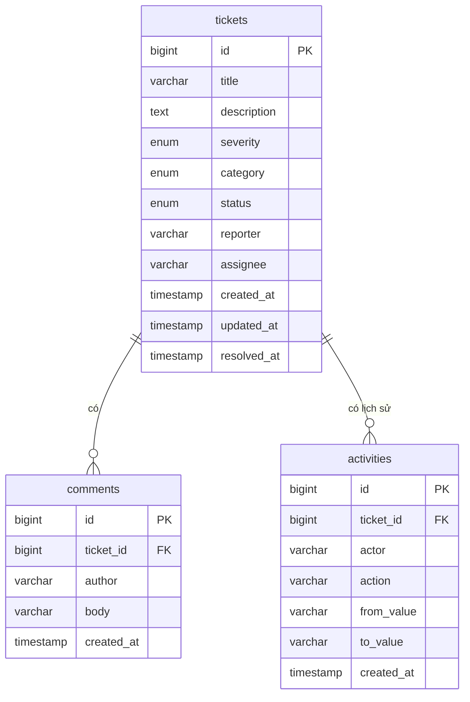

# Database schema — OpsBoard

MySQL 8.4 (Flexible Server trên Azure, container `mysql:8.4` khi chạy local). Charset `utf8mb4`, engine InnoDB.
Liên quan: [api-spec](api-spec.md) · [prd](prd.md).

## Sơ đồ quan hệ


## DDL (tạo idempotent lúc khởi động, như `EnsureSchemaAsync` hiện tại ở `app/be/Repositories/DatabaseRepository.cs`)
```sql
CREATE TABLE IF NOT EXISTS tickets (
    id           BIGINT        NOT NULL AUTO_INCREMENT,
    title        VARCHAR(200)  NOT NULL,
    description  TEXT          NULL,
    severity     ENUM('low','medium','high','critical') NOT NULL DEFAULT 'medium',
    category     ENUM('infra','app','database','network','security','other') NOT NULL DEFAULT 'other',
    status       ENUM('open','in_progress','resolved','closed') NOT NULL DEFAULT 'open',
    reporter     VARCHAR(50)   NOT NULL,
    assignee     VARCHAR(50)   NULL,
    created_at   TIMESTAMP     NOT NULL DEFAULT CURRENT_TIMESTAMP,
    updated_at   TIMESTAMP     NOT NULL DEFAULT CURRENT_TIMESTAMP ON UPDATE CURRENT_TIMESTAMP,
    resolved_at  TIMESTAMP     NULL,
    PRIMARY KEY (id),
    KEY ix_tickets_status_updated (status, updated_at),
    KEY ix_tickets_severity       (severity),
    KEY ix_tickets_assignee       (assignee),
    KEY ix_tickets_updated        (updated_at)
) ENGINE=InnoDB DEFAULT CHARSET=utf8mb4;

CREATE TABLE IF NOT EXISTS comments (
    id         BIGINT       NOT NULL AUTO_INCREMENT,
    ticket_id  BIGINT       NOT NULL,
    author     VARCHAR(50)  NOT NULL,
    body       VARCHAR(2000) NOT NULL,
    created_at TIMESTAMP    NOT NULL DEFAULT CURRENT_TIMESTAMP,
    PRIMARY KEY (id),
    KEY ix_comments_ticket (ticket_id, created_at),
    CONSTRAINT fk_comments_ticket FOREIGN KEY (ticket_id) REFERENCES tickets(id) ON DELETE CASCADE
) ENGINE=InnoDB DEFAULT CHARSET=utf8mb4;

CREATE TABLE IF NOT EXISTS activities (
    id          BIGINT       NOT NULL AUTO_INCREMENT,
    ticket_id   BIGINT       NOT NULL,
    actor       VARCHAR(50)  NOT NULL,
    action      VARCHAR(30)  NOT NULL,
    from_value  VARCHAR(200) NULL,
    to_value    VARCHAR(200) NULL,
    created_at  TIMESTAMP    NOT NULL DEFAULT CURRENT_TIMESTAMP,
    PRIMARY KEY (id),
    KEY ix_activities_ticket (ticket_id, created_at),
    CONSTRAINT fk_activities_ticket FOREIGN KEY (ticket_id) REFERENCES tickets(id) ON DELETE CASCADE
) ENGINE=InnoDB DEFAULT CHARSET=utf8mb4;
```

## Quyết định thiết kế
- **ENUM ở DB** khớp enum ở code; thêm giá trị mới cần `ALTER` — chấp nhận vì tập giá trị nhỏ và ổn định.
- **Không có bảng `users`**: `reporter`/`assignee`/`author`/`actor` là chuỗi tên (không đăng nhập). Có thể tách sau khi có auth thật.
- **`activities` chỉ ghi thêm**, không sửa/xoá — là nhật ký kiểm toán.
- **Không sửa/xoá bình luận** (PRD US-06), nên không có `updated_at` ở `comments`.
- **`updated_at`** tự cập nhật; kanban và danh sách sắp theo cột này (`ix_tickets_updated`).
- **Thống kê** (`/stats`) dùng `GROUP BY status/severity`; `avg_resolution_minutes` =
  `AVG(TIMESTAMPDIFF(MINUTE, created_at, resolved_at))` trên ticket có `resolved_at`. Ở ≤ 10.000 dòng, index trên là đủ.
- **Tìm `q`**: `LIKE '%q%'` trên `title`, không index (chấp nhận ở quy mô này). Tham số hoá; escape `%`, `_`,
  `\` trong chuỗi người dùng nhập trước khi ghép vào pattern; `q` tối đa 100 ký tự (từ chối ở backend, không
  tự cắt) — xem `api-spec.md`.
- **`from_value`/`to_value`** (`VARCHAR(200)`) không đủ cho `description` (tới 5000 ký tự): với action
  `title_changed`/`description_changed`, hai cột này luôn `NULL` — lịch sử chỉ ghi nhận "đã đổi", không lưu
  nội dung cũ/mới (xem `api-spec.md`).
- **Thời gian**: mọi cột `timestamp` lưu và đọc theo UTC. MySqlConnector trả `DateTime` với
  `Kind=Unspecified`; map sang DTO phải gán `DateTimeKind.Utc` trước khi serialize, không gán thì JSON trả
  ra thiếu hậu tố `Z` (xem `api-spec.md`).
- **Đổi trạng thái** làm trong một transaction: `UPDATE tickets` + `INSERT activities`, để không lệch.

## Chuyển từ schema hiện tại
Bảng `nodes` (`id`, `name`, `address`, `role`, `last_seen_at`) bị **thay thế** bởi `tickets`. Dữ liệu dev/demo bỏ được,
nên không cần migrate dữ liệu: tạo bảng mới lúc khởi động, bỏ `nodes` khỏi code. Trên Azure đang chạy, bảng `nodes`
cũ để yên (vô hại) hoặc xoá trong lần `make down` kế tiếp (DB bị huỷ cùng môi trường).

## Truy cập
Kết nối bằng MySqlConnector qua TLS (`DB_TLS=true`); mật khẩu lấy từ Key Vault (`@Microsoft.KeyVault(...)`).
Firewall chỉ mở cho outbound IP của App Service (M3).
